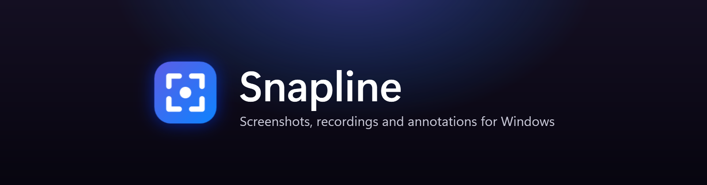
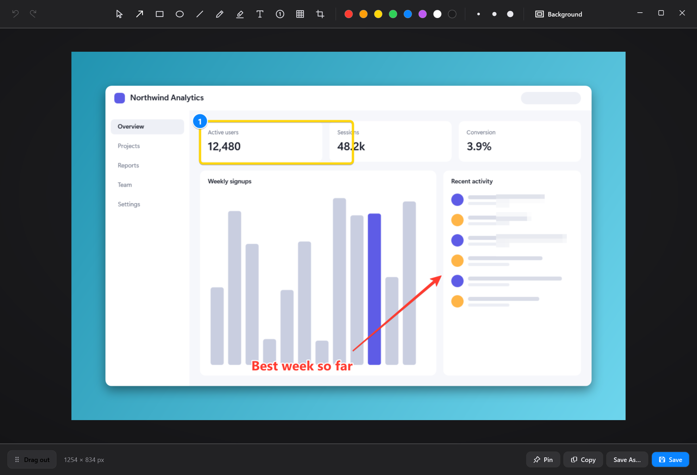
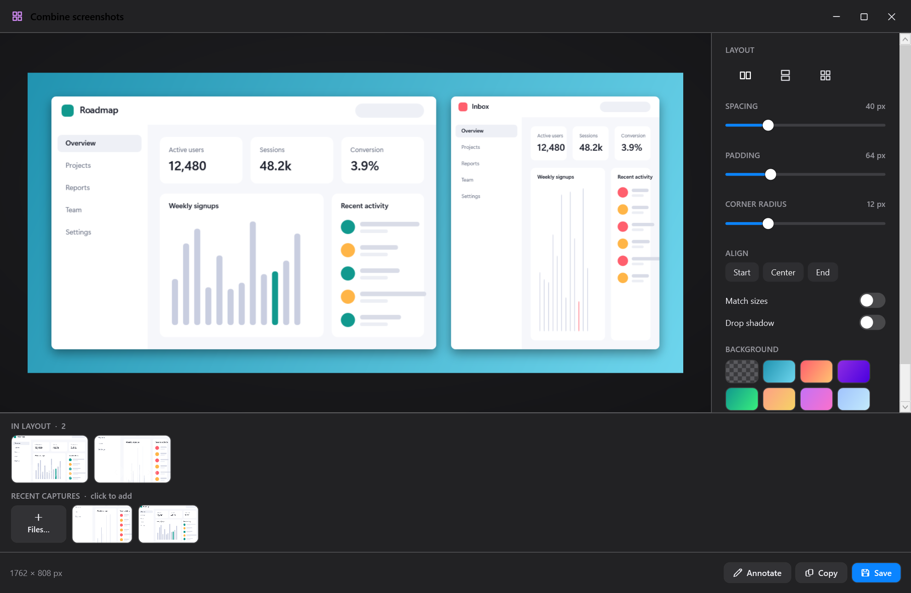
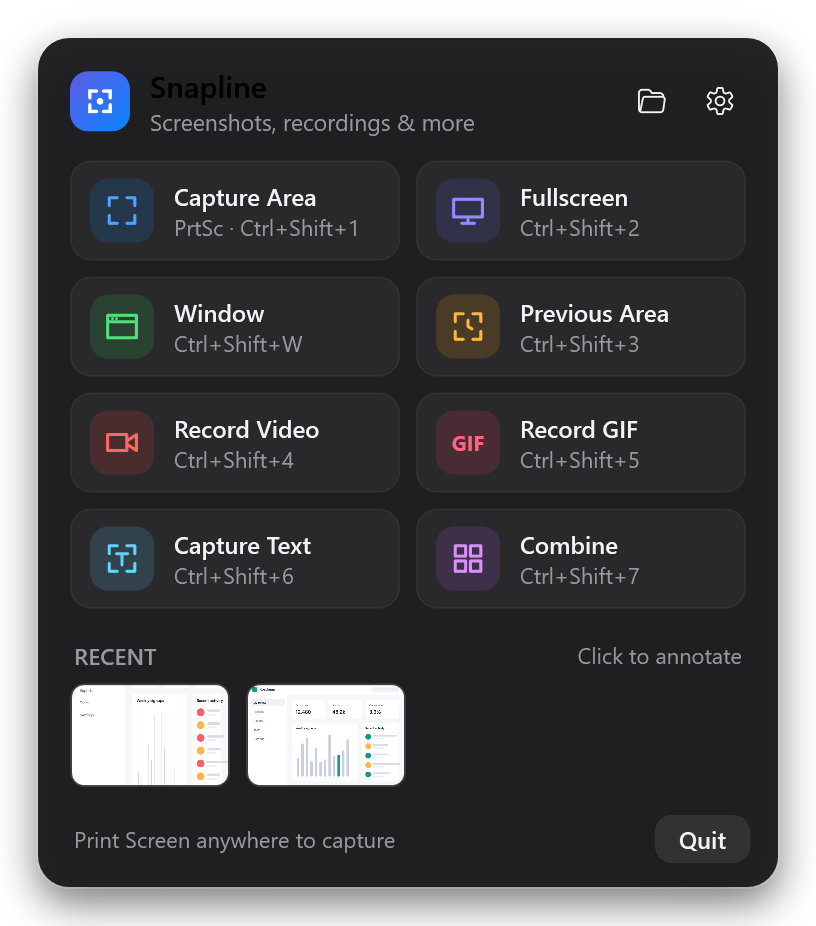
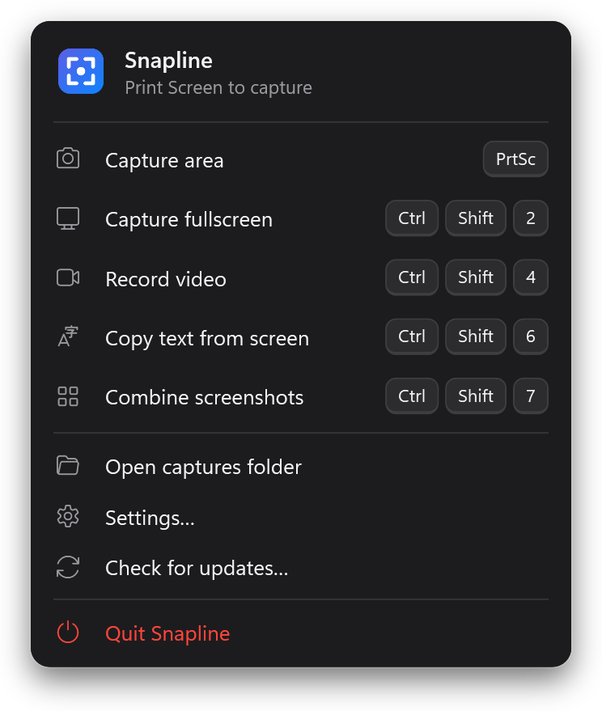
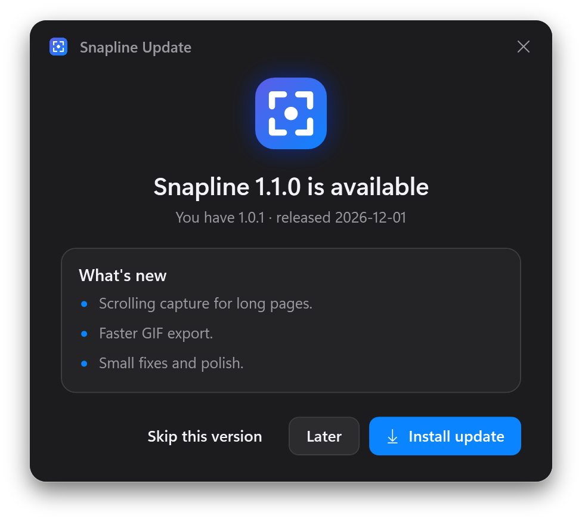
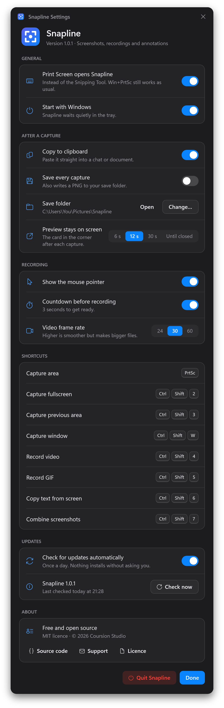

<p align="center">
  
</p>

<p align="center">
  <a href="https://github.com/Coursion-Studio/Snapline/releases/latest"></a>
  <a href="https://github.com/Coursion-Studio/Snapline/releases"></a>
  
  
  <a href="LICENSE.md"></a>
  <a href="https://github.com/Coursion-Studio/Snapline/actions/workflows/ci.yml"></a>
</p>

<p align="center">
  <b>Snapline for Windows.</b><br>
  Press <kbd>Print Screen</kbd>, drag, done. Then annotate, record, combine or copy the text.
</p>

<p align="center">
  <a href="https://github.com/Coursion-Studio/Snapline/releases/latest"><b>⬇ Download Snapline</b></a>
  &nbsp;·&nbsp; <a href="#-install">Install</a>
  &nbsp;·&nbsp; <a href="#-features">Features</a>
  &nbsp;·&nbsp; <a href="#-screenshots">Screenshots</a>
  &nbsp;·&nbsp; <a href="#%EF%B8%8F-shortcuts">Shortcuts</a>
  &nbsp;·&nbsp; <a href="#-faq">FAQ</a>
  &nbsp;·&nbsp; <a href="#%EF%B8%8F-build-from-source">Build from source</a>
</p>

---

<p align="center">
  
</p>

## 🚀 Install

1. Download **`SnaplineSetup-x.y.z.exe`** from the [latest release](https://github.com/Coursion-Studio/Snapline/releases/latest).
2. Open it and click **Install**. Snapline installs just for you, so **no admin rights** are needed.
3. Press **Print Screen**, then drag over what you want to capture.

Setup adds Snapline to the **Start menu**, can **start it with Windows**, and registers it under
**Settings → Apps → Installed apps**. Snapline **updates itself**: it checks once a day and installs new versions
with one click. Every update is signed by Coursion Studio.

> **"Windows protected your PC"?** This SmartScreen warning appears because the installer isn't code-signed yet.
> Click **More info → Run anyway**. Each release includes a `.sha256` file so you can verify the download.

**Uninstall:** **Settings → Apps → Installed apps → Snapline → Uninstall**. You can choose whether to keep your settings.

**Requirements:** Windows 10 (version 2004 or later) or Windows 11. Everything Snapline needs is included, so there's nothing else to install.

## ✨ Features

|   |   |
|---|---|
| 📸 **Print Screen, drag, done** | Drag over an area or click a window. The capture is copied, ready to paste, and waits in a small card in the corner. |
| ✏️ **Annotate** | Arrows, boxes, circles, a pen and highlighter, text, numbered steps and blur, with undo. Add a gradient background and rounded corners in one click. |
| 🎬 **Record video and GIFs** | Record any part of the screen as MP4 or GIF, with an optional 3-second countdown and the mouse pointer shown or hidden. |
| 🧩 **Combine screenshots** | Put several captures side by side, stacked, or in a grid, with spacing, padding and a background. |
| 🔤 **Copy text from the screen** | Drag over any text, even in an image or video, and it's copied as text. |
| 📌 **Pin and drag** | Pin a capture so it floats above other windows, or drag it straight into a chat, email or document. |
| 🔄 **Automatic updates** | Checks once a day, shows what's new, and installs with one click. Every update is signed by Coursion Studio. |
| 🔒 **Private and open source** | Runs entirely on your PC. No account, no analytics, no telemetry. The only network call is the daily update check. MIT licensed. |

## 📸 Screenshots

<p align="center">
  
</p>
<p align="center">
  
  
  
</p>
<p align="center">
  
</p>

## ⌨️ Shortcuts

| Do this | Press |
|---|---|
| Capture an area or a window | <kbd>Print Screen</kbd> or <kbd>Ctrl</kbd>+<kbd>Shift</kbd>+<kbd>1</kbd> |
| Capture the full screen | <kbd>Ctrl</kbd>+<kbd>Shift</kbd>+<kbd>2</kbd> |
| Capture the same area again | <kbd>Ctrl</kbd>+<kbd>Shift</kbd>+<kbd>3</kbd> |
| Capture a window | <kbd>Ctrl</kbd>+<kbd>Shift</kbd>+<kbd>W</kbd> |
| Record video (press again to stop) | <kbd>Ctrl</kbd>+<kbd>Shift</kbd>+<kbd>4</kbd> |
| Record a GIF (press again to stop) | <kbd>Ctrl</kbd>+<kbd>Shift</kbd>+<kbd>5</kbd> |
| Copy text from the screen | <kbd>Ctrl</kbd>+<kbd>Shift</kbd>+<kbd>6</kbd> |
| Combine screenshots | <kbd>Ctrl</kbd>+<kbd>Shift</kbd>+<kbd>7</kbd> |
| Cancel a capture | <kbd>Esc</kbd> or right-click |
| Make the selection square | hold <kbd>Shift</kbd> while dragging |

## ❓ FAQ

<details>
<summary><b>I want Print Screen to open the Snipping Tool again</b></summary>

Right-click the Snapline tray icon → **Settings… → General** and turn off **Print Screen opens Snapline**.
<kbd>Ctrl</kbd>+<kbd>Shift</kbd>+<kbd>1</kbd> still captures with Snapline. <kbd>Win</kbd>+<kbd>Print Screen</kbd>
always works as Windows' own shortcut.
</details>

<details>
<summary><b>Where are my captures saved?</b></summary>

Every capture is copied to the clipboard. To keep a file, click **Save** on the card or in the editor, or turn on
**Settings… → After a capture → Save every capture**. Files go to **Pictures\Snapline** unless you pick another
folder there. Recordings are always saved to that folder.
</details>

<details>
<summary><b>Where are the settings?</b></summary>

Right-click the Snapline icon in the tray (near the clock) and choose **Settings…**, or left-click it and click the gear.
If you can't see the icon, click the <b>^</b> arrow next to the tray icons.
</details>

<details>
<summary><b>Does Snapline send my screenshots anywhere?</b></summary>

No. Captures, recordings and text recognition stay on your PC. The only thing Snapline downloads is the update
information once a day, and you can turn that off in **Settings… → Updates**.
</details>

## 🛠️ Build from source

You need Windows 10 or 11 and the [.NET 8 SDK](https://dotnet.microsoft.com/download/dotnet/8.0).

```powershell
git clone https://github.com/Coursion-Studio/Snapline.git
cd Snapline
dotnet test Snapline.sln          # unit tests
.\build.ps1                       # bin\Snapline.exe and bin\SnaplineSetup.exe
```

`bin\Snapline.exe` is a single self-contained file, so it runs without installing .NET. The installer is
compiled with the C# compiler that ships with Windows, so it needs nothing extra either.

| Folder | What's in it |
|---|---|
| `Snapline/Core` | capture, recording (MP4 and GIF), text recognition, hotkeys, Print Screen, settings |
| `Snapline/UI`, `Snapline/Editor` | capture overlay, preview cards, editor, combine, tray panel, settings |
| `Snapline/Shared` | Snapline's small UI toolkit, shared with the installer |
| `Snapline/Updates` | update check, download and signature verification |
| `setup` | per-user installer and uninstaller |
| `tests` | unit tests |
| `tools` | release and signing scripts ([docs/RELEASING.md](docs/RELEASING.md)) |

Every push is built and tested by [GitHub Actions](https://github.com/Coursion-Studio/Snapline/actions).

## 🔏 Code signing

Snapline has applied for free code signing for open-source projects: signing by [SignPath.io](https://about.signpath.io),
certificate by [SignPath Foundation](https://signpath.org). Until that's approved, releases are unsigned and Windows
shows a SmartScreen warning the first time you run the installer. The [code signing policy](CODE_SIGNING_POLICY.md)
explains who builds, approves and signs releases.

## 🐛 Issues & feedback

[Open an issue](https://github.com/Coursion-Studio/Snapline/issues), or email
[support@coursion.studio](mailto:support@coursion.studio). Pull requests are welcome.

## 📄 Licence

[MIT](LICENSE.md). © 2026 Coursion Studio · [coursion.studio](https://coursion.studio)
